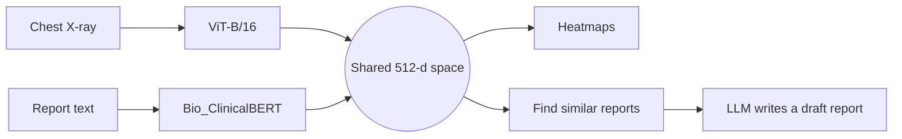
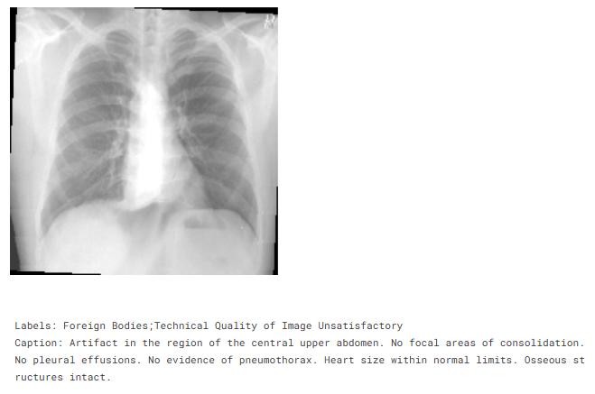
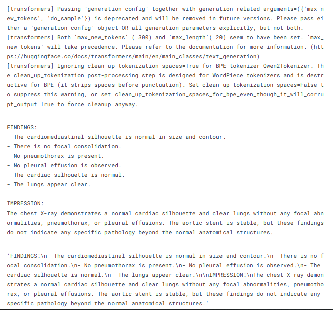
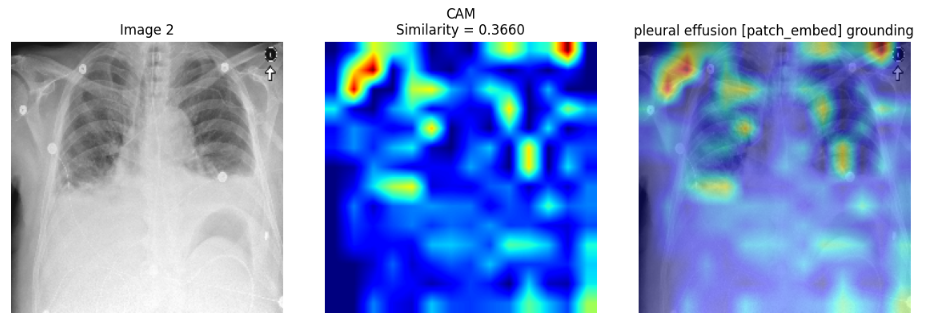
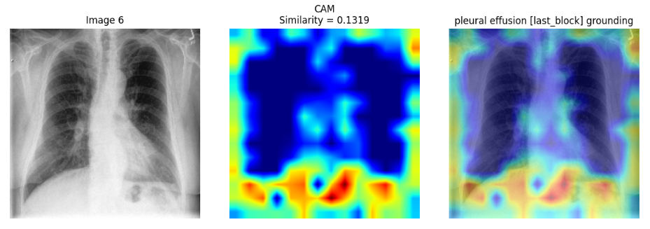

# Chest X-ray + Report AI: A Small Research Project

[](https://www.kaggle.com/code/atenazare/chest-ai-assistance)

Hi! This is my small research project on medical AI. I trained a model that connects chest X-ray images with their radiology reports. Then I used this model for three things:

- finding the most similar reports for a new X-ray,
- showing heatmaps on the image for a text like "pleural effusion",
- helping a language model (LLM) write a draft report.

I did this project to learn more about multimodal learning in medicine. I also wanted to test my results carefully, not only build a demo.

> ⚠️ This is a student research project. It is not a medical tool, and it should not be used for real patients.

### Main results in short

- **Classification from text prompts works well for big findings:** AUROC **0.92** for pleural effusion and **0.87** for cardiomegaly, but only 0.58 for nodules.
- **Finding the exact report is hard:** the correct report is in the top 5 for **5.0%** of test images. This is more than 7 times better than random (0.65%), but still low.
- **Heatmaps:** heatmaps from the last transformer block were a bit better than random on expert boxes, mostly because of cardiomegaly. Heatmaps from the patch-embedding layer (my first version) were **worse than random**.
- **LLM:** the LLM was not more correct than simply copying the most similar report. When I added a knowledge base, it added more findings that had no support (**16.7%**).

---

## Why I did this

Chest X-rays are one of the most common medical images. Each X-ray usually comes with a report written by a radiologist. So we already have a kind of "free" label: the report text. Models like CLIP can learn from image–text pairs without extra manual labels.

But most medical CLIP papers use very large datasets and strong GPUs. I only had a free Kaggle GPU and a small dataset. So I wanted to see how far a small model can go in this setting.

I was also curious about heatmaps. They look nice, but do they really show what the model learned? I wanted to check this with real tests.

## My research questions

1. **RQ1 – Training with little data:** Which training choices matter most? I compared two loss functions (CLIP and SigLIP), three batch sizes (16, 64, 256), and three ways of choosing "positive" pairs.
2. **RQ2 – Can we trust the heatmaps?** Do the heatmaps change when the model weights are random? Do they point to the right area of the image?
3. **RQ3 – Does the LLM really help?** Does it make the draft report more correct, or does it add findings that are not supported by the evidence?

---

## How it works



- **Image encoder:** ViT-B/16, pretrained on ImageNet.
- **Text encoder:** Bio_ClinicalBERT, a BERT model trained on clinical notes.
- **Projection heads:** two small networks that map images and texts into the same 512-dimensional space. After training, an X-ray and its own report should be close to each other in this space.
- **Heatmaps:** a Grad-CAM method. It shows which parts of the image make the similarity with a text (for example "pleural effusion") higher.
- **Report drafting:** for a new X-ray, the model finds the 3 most similar reports from the training set. I take keywords from these reports, search a small knowledge base with FAISS, and give everything to an LLM (Qwen2.5-3B-Instruct). The LLM does not see the image. It only sees text.

---

## Dataset

I used the **Indiana University Chest X-ray dataset** (Kaggle version). It has X-ray images and their reports (`findings` and `impression`).

Some choices I made:

- I used only **frontal** images.
- I split the data **by study, not by image**. In my first version, I split by image. Later I noticed that the frontal and the lateral image of the same study have the same report. So the same report could be in both the training set and the test set. This can make the results look better than they really are. Splitting by study fixed this problem.
- Many reports in this dataset are **exactly the same** (mostly normal cases). This is a problem for the CLIP loss, because it treats these identical reports as "wrong" matches. So I also tried two other ways of choosing positive pairs: pairs with the **same text**, and pairs with the **same labels** (the IU `Problems` labels).

| Split | Images | Unique reports |
|---|---|---|
| Train (70%) | 2,647 | 2,033 |
| Validation (10%) | 383 | 329 |
| Test (20%) | 764 | 629 |

**30.2%** of the training pairs share an identical report with another pair.

<!-- ADD IMAGE: Section 2, the cell "Display the first 5 images and captions".
     Save 2–3 of the images (right-click > Save image) and put them side by side in one picture.
     File name: figures/01_data_samples.png -->


---

## Training

I trained the model in two steps:

1. **Fast experiments with frozen encoders.** I froze the ViT and BERT, saved their features once, and trained only the projection heads. Each run took only a few seconds, so I could test all 18 settings with 3 random seeds. I chose the best setting using the **validation** set, not the test set. The best one was **CLIP loss + same-label positives + batch 64**.
2. **Full fine-tuning.** Then I trained the whole model with this setting. I used batch size 16 because of GPU memory. Training stopped early, and the best epoch on the validation set was **epoch 2**.

---

## Results

All numbers below come from the **test set** (764 images), unless I say something else.

### RQ1: Matching images and reports

**Recall@5** means: how often the correct report is in the top 5 results (out of 764). The frozen results are mean ± std over 3 seeds.

| Setup | Image→Text R@1 (%) | Image→Text R@5 (%) | Text→Image R@5 (%) | Effusion AUROC |
|---|---|---|---|---|
| Random guess | 0.13 | 0.65 | 0.65 | 0.50 |
| My first setup (CLIP, normal positives, batch 16, frozen) | 0.35 ± 0.33 | 2.66 ± 0.53 | 4.49 ± 0.53 | 0.73 ± 0.09 |
| Best frozen setup on validation (CLIP, same labels, batch 64) | 0.48 ± 0.08 | 2.23 ± 0.39 | 4.01 ± 0.54 | 0.73 ± 0.04 |
| Same setup + full fine-tuning | **1.05** | **4.97** | **4.45** | **0.92** |

After fine-tuning, the median rank of the correct report was 155 out of 764.

**How positive pairs change the Effusion AUROC** (frozen encoders, mean over 3 seeds):

| Loss | Batch | Normal positives | Same text | Same labels |
|---|---|---|---|---|
| CLIP | 16 | 0.73 | 0.71 | **0.81** |
| CLIP | 64 | 0.72 | 0.69 | **0.73** |
| CLIP | 256 | 0.77 | 0.77 | **0.81** |
| SigLIP | 16 | 0.68 | 0.70 | **0.82** |
| SigLIP | 64 | 0.77 | 0.78 | **0.80** |
| SigLIP | 256 | 0.73 | 0.78 | **0.85** |

**Classification from text prompts** (fine-tuned model). The model compares each image with two short texts, for example "pleural effusion" and "no pleural effusion".

| Finding | Positive test images | AUROC | 95% CI |
|---|---|---|---|
| Pleural effusion | 27 | **0.923** | 0.879–0.960 |
| Cardiomegaly | 78 | **0.869** | 0.835–0.901 |
| Edema | 14 | 0.819 | 0.685–0.936 |
| Atelectasis | 63 | 0.747 | 0.677–0.809 |
| Opacity | 75 | 0.736 | 0.679–0.795 |
| Nodule | 15 | 0.577 | 0.425–0.716 |
| Pneumothorax | 9 | – (too few cases) | – |

> **Note:** my final model was trained with "same labels" positives, which use the IU labels of the *training* images. So this is not a pure zero-shot result. The test labels were never used in training.

**What I found:**
- Finding the one exact report is hard on this dataset. Many reports are very similar to each other, so the model often finds a close report, but not the exact one.
- Full fine-tuning helped a lot for image→text retrieval (R@5 from about 2–3% to 5.0%) and for effusion AUROC (from 0.73 to 0.92). Text→image retrieval did not change much.
- "Same labels" positives gave the highest effusion AUROC in **all 6** loss/batch settings, but they did not clearly help retrieval. I think they teach the model "which finding is there" more than "which exact report belongs to this image".
- CLIP and SigLIP were close at batch 16 and 64. SigLIP with batch 256 was almost at random level for retrieval. But I trained all batch sizes for the same number of epochs, so batch 256 got 16 times fewer updates than batch 16. So I cannot say that big batches are bad. I need to repeat this test with the same number of training steps.
- The model works well for big findings (effusion, cardiomegaly) but not for nodules (0.58, and the CI includes 0.5). Nodules are small, and the 224×224 input may lose them.

<!-- ADD IMAGE: Section 5, output of test_trained_models().
     Choose 2 good examples and 1 bad example (image + original report + predicted report).
     File name: figures/02_retrieval_examples.png -->


### RQ2: Can we trust the heatmaps?

I compared two layers of the ViT:
- the **patch embedding layer** (what I used in my first version, very close to the raw pixels),
- the **last transformer block**.

For each test image, I show the heatmap for the text "pleural effusion". The first 3 images have effusion and the last 3 do not.

<!-- ADD IMAGES: Section 6, the heatmap cell. It makes two figures:
     the first one is [patch_embed], the second one is [last_block].
     File names: figures/03_heatmaps_patch_embed.png and figures/04_heatmaps_last_block.png -->
<p align="center">
  
  &nbsp;
  
</p>
<p align="center"><i>Left: patch embedding layer. Right: last transformer block.</i></p>

**Test 1 – Sanity check.** I made the model weights random, step by step from the top, and compared the new heatmap with the old one (Spearman correlation, 6 test images). A value near 0 means the heatmap changed completely, which is what we want: it shows that the heatmap depends on what the model learned.

| Layer | After randomizing the top 1 block | After randomizing all 12 blocks |
|---|---|---|
| Patch embedding | 0.53 | −0.05 |
| Last block | −0.11 | 0.14 |

**Test 2 – Pointing game.** I used 984 expert boxes from the **NIH ChestX-ray14** dataset. The model never saw this dataset. A "hit" means the hottest point of the heatmap is inside the box. "Energy inside box" is the part of the heatmap that falls inside the box. A random heatmap gets the size of the box on average, so that is the baseline.

| Layer | Hit rate | Energy inside box |
|---|---|---|
| Patch embedding (first version) | 1.9% | 5.9% |
| Last block | **9.9%** | **9.2%** |
| Random heatmap (baseline) | 7.5% | 7.5% |

Hit rate per finding:

| Finding | Last block | Patch embedding | Random baseline |
|---|---|---|---|
| Cardiomegaly | **30.8%** | 3.4% | 17.6% |
| Infiltrate | 13.0% | 1.6% | 9.7% |
| Pneumonia | 12.5% | 0.8% | 9.4% |
| Effusion | 7.2% | 2.0% | 6.9% |
| Mass | 3.5% | 0.0% | 4.2% |
| Pneumothorax | 3.1% | 3.1% | 5.2% |
| Atelectasis | 1.7% | 2.8% | 3.2% |
| Nodule | 1.3% | 0.0% | 0.5% |

**What I found:**
- Both layers pass the sanity check: when the weights are random, the heatmaps change a lot. But the patch-embedding heatmap stays partly the same (0.53) when only the top block is random. So part of it comes from simple image patterns, not from what the model learned.
- On the NIH boxes, the last block was a bit better than random (9.9% vs 7.5%). The patch-embedding layer from my first version was **worse than random** (1.9%). So moving the heatmap to the last block was the right choice.
- The last block worked clearly only for **cardiomegaly** (30.8% vs 17.6%). For small or thin findings like nodules, masses and pneumothorax, it was at or below random.
- The most interesting result for me: the model detects pleural effusion well (AUROC 0.92), but its effusion heatmaps are almost random (7.2% vs 6.9%). So a model can give the right answer and still not show where the evidence is. (One caution: the AUROC is measured on IU, and the pointing game on NIH, which is a different dataset.)

### RQ3: Does the LLM help?

I compared three outputs with the real report of each test image (first 50 test images):

| Output | Clinical F1 (micro) | Clinical F1 (macro) | Unsupported findings |
|---|---|---|---|
| Top-1 similar report (copied as it is) | 0.129 | 0.092 | 0% (by design) |
| LLM + 3 similar reports | **0.130** | **0.123** | 6.7% |
| LLM + 3 similar reports + knowledge base | 0.087 | 0.045 | 16.7% |

- **Clinical F1:** do the findings in the output (for example "cardiomegaly") match the findings in the real report?
- **Unsupported findings:** the share of findings in the output that do not appear in any of the 3 similar reports. A high number means the LLM is adding things by itself.

**One example:**

| | Text |
|---|---|
| Real report | Borderline cardiomegaly. Midline sternotomy. Enlarged pulmonary arteries. Clear lungs. |
| Top-1 similar report | Stable position of the aortic stent with a normal cardiac silhouette and clear lungs. |
| LLM + knowledge base (short) | "...a normal cardiac silhouette and clear lungs without any focal abnormalities... The aortic stent is stable..." |

The model found a patient who also had heart surgery, which is partly right. But it missed the borderline cardiomegaly. The LLM also wrote "the aortic stent is stable", which is true for the *other* patient, not for this one. This shows the main risk of this pipeline: the LLM can describe a similar patient instead of the real one.

**What I found:**
- The LLM alone had almost the same micro F1 as copying the top-1 report (0.130 vs 0.129), and a bit better macro F1. But 6.7% of its findings were not in any of the similar reports.
- Adding the knowledge base made things worse: F1 dropped to 0.087, and unsupported findings went up to 16.7%. I think the LLM takes findings from the medical text and writes them as if they are in the image.
- Clinical F1 is low for all three outputs, because the similar reports are often not similar enough. The LLM cannot fix bad retrieval.
- These results come from only 50 test images, so they are a first look, not a final answer.

---

## What I learned

- Small mistakes in the data split can make the results look much better than they really are.
- Training, testing and retrieval must use the model in exactly the same way. In my first version, the text was encoded in different ways in different parts of the code.
- A heatmap can look nice and still not explain the model. My first heatmap layer was worse than random on expert boxes.
- A model can classify a finding well and still not show where it is.
- More context for an LLM is not always better. In my case, the knowledge base made the reports less correct.

## Limitations

- The dataset is small and comes from one hospital system. The validation set has only 383 images, so choosing the best setting and the best epoch is noisy.
- The image encoder was pretrained on ImageNet, not on X-rays, and the images are only 224×224.
- In the frozen experiments, all batch sizes had the same number of epochs, so bigger batches had fewer updates.
- "Same labels" positives use the IU training labels, so the classification results are not pure zero-shot.
- The labels I used for evaluation (IU `Problems` and a keyword-based labeler) are not perfect.
- The sanity check used only 6 images, and the LLM test used only 50 images.
- Grad-CAM heatmaps are coarse (14×14 patches).
- The LLM never sees the image. It can only repeat or combine what is in the similar reports.

## Next steps

- Repeat the batch-size test with the same number of training steps for every batch size.
- Fine-tune with "same text" positives, to get a pure zero-shot result.
- Run the LLM test on all 764 test images, and use a better labeler such as CheXbert.
- Use gradient caching to train with bigger batches on a small GPU.
- Try explanation methods made for transformers (for example Chefer et al., 2021) and test them in the same way.
- Use an image encoder pretrained on chest X-rays, and test grounding on MS-CXR.
- Try a bigger dataset like MIMIC-CXR.

---

## How to run

1. Open the [Kaggle notebook](https://www.kaggle.com/code/atenazare/chest-ai-assistance) and click **Copy & Edit**.
2. Turn on the **GPU** and **Internet** in the notebook settings.
3. Add the **NIH Chest X-rays** dataset with **Add Input**. It is only needed for the pointing game in Section 6.
4. Run the cells in order. After Phase A (Section 5), look at the validation table and set `BEST_LOSS` and `BEST_POS` from its first row.
5. All result tables are saved as CSV files in `/kaggle/working`.

Full fine-tuning can take up to about 2 hours on a Kaggle GPU (it stops early if the validation score stops improving). The LLM part in Section 7 is also slow, so you can start with a small `N`.

## Files

```
chest-ai-assistance.ipynb   # the full notebook
README.md
requirements.txt
results/                    # CSV files from the notebook
figures/                    # images used in this README
```


If you have any questions or ideas, feel free to open an issue or contact me: [zrefatimah@gmail.com]
